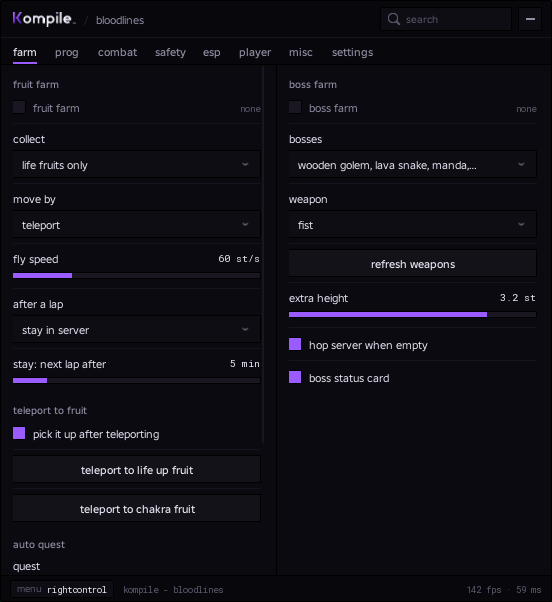
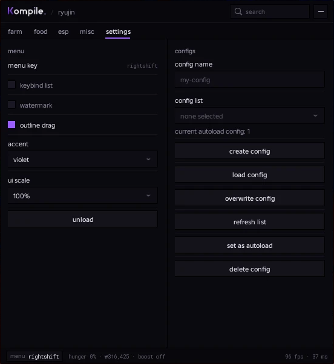
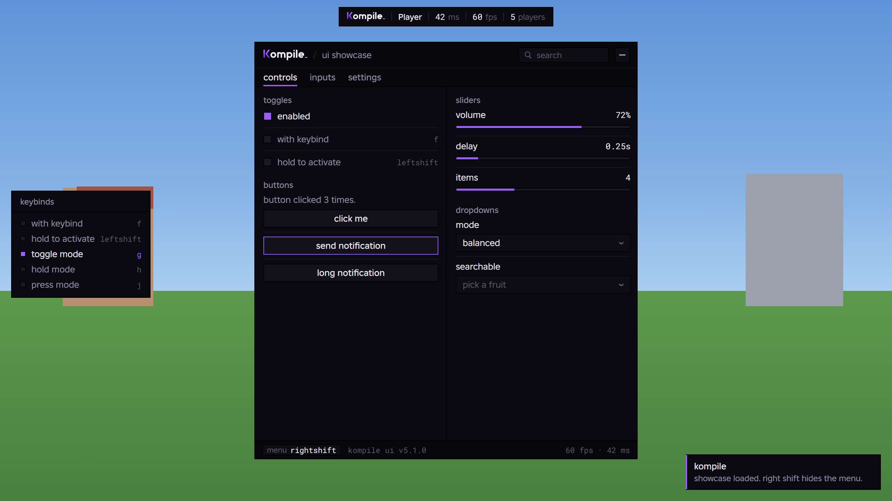
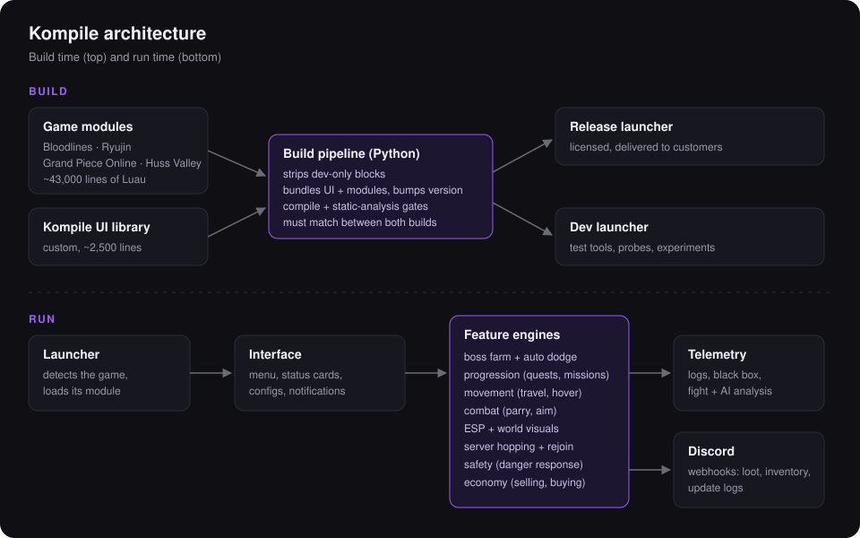

<h1 align="center">Kompile</h1>

  <b>A multi-game Roblox script hub, built and run as a product.</b> 
  Custom UI library · per-game automation engines · build pipeline · telemetry

  
  
  
  

---

## Overview

Kompile is a script hub for Roblox games that I designed, wrote, and maintain on my own. It loads into a game, detects which one it's in, and gives the player a full in-game menu of automation, combat, visual and quality-of-life features built specifically for that game.

The largest module, for the game **Bloodlines**, is about **44,000 lines** of Luau with **130+ toggles and 100+ actions**. Kompile is sold to customers with license keys and a Discord community. I ship versioned updates often, sometimes several in a day, and keep it working through the target game's own updates.

> **Note:** this repository is a showcase. The source code is private, so nothing here is code from the project.

## At a glance

| | |
|---|---|
| **Supported games** | Bloodlines, Ryujin, Grand Piece Online, Huss Valley |
| **Code** | ~50,000 lines across game modules, plus a ~4,400-line UI library |
| **Interface** | 8 tabs, 55+ feature panels, live status cards, configs per account |
| **Releases** | Versioned public updates (v1.3 to v1.24 in October 2026), release and dev channels |
| **Tooling** | Python build pipeline, static analysis gates, binary file parser, in-game recorders |

## Screenshots

  
  &nbsp;
  

Left: Kompile for Bloodlines (farm tab). Right: Kompile for Ryujin (settings and configs).

  

The Kompile UI library: toggles with keybinds, sliders, dropdowns, a keybind list, a watermark and notifications.

## Architecture

  

- **Game modules.** One module per game. Each owns its features and talks to the shared interface.
- **Kompile UI library.** My own UI framework: windows, tabs, panels, toggles, sliders, searchable dropdowns, keybinds (toggle and hold), color pickers with transparency, a live ESP preview panel, custom rows, a search bar that finds any setting, tooltips, a keybind list, a watermark, notifications, configs with autoload, theming and scaling. It also powers the live status cards.
- **Build pipeline.** A Python script assembles each launcher from the sources. It strips the dev-only code out of the release build, bumps the version, and checks both builds with a compiler and a static analyzer before anything ships. If the two builds disagree, it doesn't ship.
- **Two channels.** A **release** launcher for customers, and a **dev** launcher with test buttons, probes and experiments. A feature lives in dev until it has been tested, then moves to release.
- **Telemetry.** Every system logs what it decides and why: a "black box" ring buffer, per-fight analysis, death reports, and more. Bugs get diagnosed from data instead of guesses.

## Features: Bloodlines

### Farming and automation
- **Boss Farm:** finds the selected bosses across the map, engages them, holds a safe position above each boss, and fights with the game's own attacks. Bosses are prioritized by expected loot.
- **Auto dodge:** reacts to each boss's individual moves as they start. Rises, sidesteps or repositions per move, with timing tuned from recorded fights, and handles moves that overlap.
- **Auto loot:** sweeps the boss room after each kill and writes a loot report.
- **Boss status card:** a live 3D portrait of the boss, an animated HP bar, its state, and multi-phase shield tracking.
- **Tailed Beast Farm and Hop:** hunts the game's world bosses and moves between servers to find them.
- **Fruit, Ryo, Switchpowder, Awakening and Age farms:** dedicated loops for each of the game's resources.
- **Drop collector:** picks up valuable items as they appear, with a Discord notification for each.
- **Auto Quest:** completes the game's quests end to end.
- **Economy:** auto sell gems and trinkets (with a never-sell list), auto buy food, auto eat, ring upgrades.
- **Inventory webhook:** posts a rendered picture of your valuables to Discord every few servers.

### Progression
- **Auto Prog:** a full character-progression loop. It joins a village, runs missions and quests, breaks chakra points one per age-up, sells and restocks, then waits safely for the next age.
- **Ember Farm** (in development): a long-term progression plan with its own status card.

### Combat
- **Auto Parry:** detects incoming attacks from their animations and blocks at the right moment. It compensates for ping automatically, has a per-move editor, recovers from stuns, and never parries whitelisted players.
- **Silent Aim:** aims skills and projectiles at a chosen target, with prediction, a visibility check and an adjustable field of view.
- **Player Farm:** follows and fights a selected player.
- **Hitbox and self visualizers** for tuning.

### Movement
- **Fly** (with a speed cap), **Noclip**, **Infinite Jump**, **No Fall Damage**, **No Ragdoll**, **Auto Run**, **Auto Chakra Dash**.
- **Teleports:** to chakra points (it checks for players first), to players, to fruit.
- **Anti-AFK.**

### ESP and visuals
- **Player ESP:** boxes or brackets, health, chakra and blood bars, tags, distance, and the tool or jutsu each player is holding.
- **Item ESP** and **Mob ESP**, plus **Spectate** (including from the leaderboard).
- **World:** no fog, no rain (sound included), no fire, fullbright.
- **Clothing:** outfits and custom clothing IDs. **Emotes** and poses that only you can see.
- **My Stats** window, **Chakra Sense** bar with alerts, and **Streamer Mode**, which replaces your name everywhere on screen.

### Safety and reliability
- **Danger Response:** pauses, moves to one of two safe spots, or changes server when you're sensed or someone comes near.
- **Staff detection:** notifies you and reacts when staff join.
- **Server hopping:** smart server picking (joinable sizes, recent visits, failed joins), **Stay In Server** mode, and graceful handling of server shutdowns.
- **Auto rejoin:** clicks through the game's title screen, lobby and quick join, so a farm resumes by itself after a hop.
- **Safe mode:** individual features can be locked off for every user at once, including old configs and keybinds, when the game changes.

### Services
- Remote shop and NPC services, plus body and appearance options, without walking to the NPC.

## Other supported games

- **Ryujin:** job automation (farm and food), boss-skill dodging, ESP, staff check, movement tools.
- **Grand Piece Online:** movement and quality-of-life tools, plus a seasonal event helper.
- **Huss Valley:** game-specific helpers.

## Companion projects

- **Kompile UI library:** the open-source UI framework every module is built on ([snapsnarvmorvid/Kompile](https://github.com/snapsnarvmorvid/Kompile)), with a showcase of every element and a small working example hub that runs in any Baseplate.
- **Kompile Clicker:** a Windows desktop auto clicker in C# / WPF, with a custom theme, a mini window, global input hooks and range-randomized timing.
- **Kompile website:** landing page and terms of service for the product.

## Engineering highlights

- **Reverse engineering.** I study each game's client code to learn how its systems work: how boss AI picks attacks, how a boss's shield absorbs damage, how a dungeon's buttons are pressed. Then I build features that fit those rules exactly.
- **Binary file parsing.** I wrote a Python parser for Roblox's binary place format (chunk decompression with LZ4 and Zstandard, interleaved integer and float encodings, instance trees, attributes). I use it to map new areas and the scripts inside them.
- **Data-driven tuning.** In-game recorders capture fights frame by frame: which animation played, where I was, what hit me and how hard. Dodge timings and positions are set from those recordings, then re-checked after each change.
- **Controlled experiments.** When the target game changes, I write small, numbered test cases into the dev build, run them in isolation, and only bring a feature back once the results are clean.
- **Fast iteration.** A one-command build with automatic checks. Every change is built, verified and versioned, so fixes can go out within minutes of a problem being reported.

## Running it as a product

Kompile is a paid product with its own customer base:
- **Licensing** through a key system, with release and development builds.
- **A Discord community** for support, announcements and bug reports.
- **Public update logs** for every release, posted automatically through webhooks.
- **Support:** customer reports (and their logs) feed directly into fixes.

## Tech

**Luau** (Roblox) · **Python** (build pipeline, binary parsing, tooling) · **C# / WPF** (desktop app) · **HTML/CSS/JS** (website) · **Discord webhooks**

---

Showcase repository. The Kompile source code is private.

